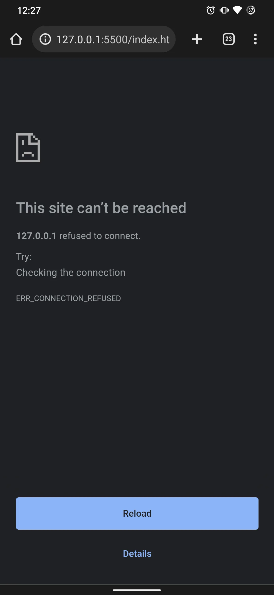
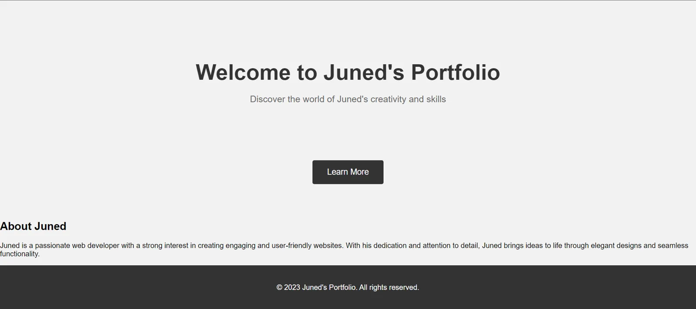
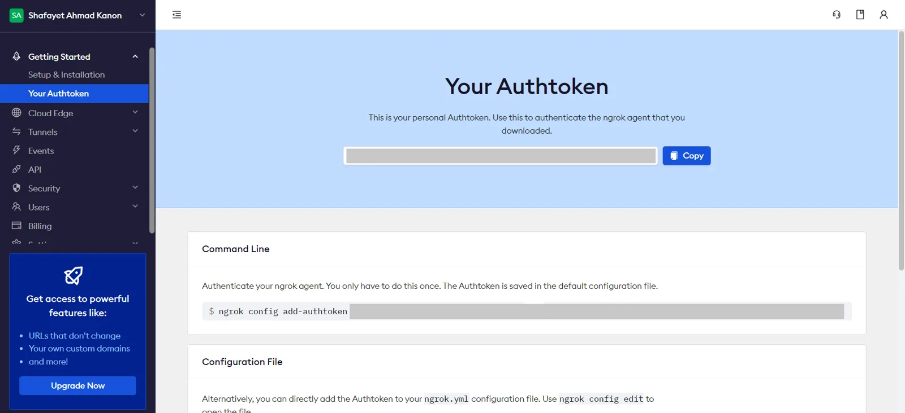
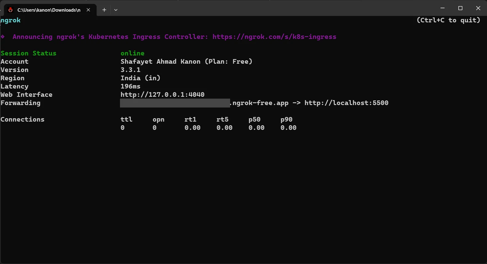

In this story-based article, we will try to understand what tunneling services are, what is their significance, their use cases, how to use a tunneling service(ngrok) and what are the limitations of tunneling services. But first, let's introduce our boy "Juned".

Once upon a time, there was a curious soul named Juned who wanted to delve into the fascinating world of web development. Eager to understand how the vast network of the internet worked.

Juned is set on a journey to unravel the mysteries behind building websites and making them accessible to people all over the world, regardless of their geographical location.


With determination in his heart, Juned began his web development journey. He downloaded "Visual Studio Code," the widely used text editor, and watches a 5-hour long tutorial on YouTube from FreeCodeCamp. Through diligent efforts, Juned mastered the basics of HTML and CSS, proudly honing his skills with the intention of creating his own website.

As Juned completed developing his Awesome website, filled with excitement, he couldn't wait to share his creation with his cousin. Bursting with pride, he eagerly sent his cousin the link to his website: `"http://127.0.0.1:5500/index.html."`

Minutes turned into hours as Juned anxiously awaited his cousin's reaction. But to his disappointment, his cousin responded with a screenshot of a blank page.



Confusion clouded Juned's mind as he asked his cousin to refresh the page, hoping it would magically display his remarkable creation. But no matter how many times they tried, nothing changed. Juned exclaimed, "But it is working perfectly on my computer!"

Now, let's demystify what went wrong with Juned's website and why it failed to appear on his cousin's phone.

The issue lies within the URL Juned shared: "[http://127.0.0.1:5500/index.html](http://127.0.0.1:5500/index.html)." This URL indicates that Juned's website is hosted(Stored) on his own computer (5500 is the port used by the Live Server extension in Visual Studio Code), specifically on the "local machine", often referred to as "[localhost](http://localhost)" or "127.0.0.1."

To understand why Juned's website remains hidden from his cousin's phone, we need to understand the concept of tunnels in web development.

A tunnel serves as a mechanism that enables a local web server(where the files of a website are kept), such as the one Juned had on his computer, to be accessible from remote devices over the internet from anywhere across the world. Essentially, it creates a secure pathway connecting the local server to the remote device(Juned's cousin's phone in our case), allowing remote access to the locally hosted website.

When Juned accessed his website on his own computer using the URL "[http://127.0.0.1:5500/index.html](http://127.0.0.1:5500/index.html)," it worked perfectly fine because the URL pointed to his own computer or local server so to say. However, when his cousin attempted to visit the website using the same URL, it failed to load. His cousin's phone could not establish a connection with Juned's local server, resulting in the blank page.

For Juned's website to be visible on his cousin's phone, he must make it available over the Internet. One approach involves deploying the website to a public web server, where the website's files are uploaded to a hosting provider that can serve the content to anyone accessing the website's URL.

If his cousin were on the same Wi-Fi network, there would be a simpler fix. His cousin could open the site using the local IP address of Juned's computer (something like `http://192.168.1.5:5500`) instead of 127.0.0.1, as long as the development server accepts connections from other devices. But his cousin is somewhere else, so Juned needs a way to reach him over the internet.

Another option is to utilize a tunneling service that creates a secure tunnel between the local server and a public URL. Such services, like ngrok, let Juned share his locally hosted website with the outside world. By using a tunneling service, Juned would acquire a public URL to share with his cousin. This URL would redirect requests through the secure tunnel to Juned's local server, enabling his cousin's phone, or any other device connected to the internet, to view the website hosted on Juned's computer.



Now, let's explore how Juned can utilize ngrok to share his incredible work with his cousin. To begin, Juned follows these steps:

### Step 1: Download ngrok

Juned visits the official ngrok website at ([https://ngrok.com/](https://ngrok.com/)) and proceeds to create a free account. After signing up, he downloads the zip file for Windows operating system.

### Step 2: Install and launch ngrok

Juned extracts the contents of the downloaded zip file. Now he can either add the path of the exe file to the system variable or he can double click the exe file and continue with the process. He goes with the easier process. He double clicks the exe file and it opens a terminal window.

Juned types the following commands:

```powershell
ngrok config add-authtoken YOUR_AUTH_TOKEN
ngrok http 5500
```

In these commands, Juned replaces YOUR\_AUTH\_TOKEN with the authentication token from his ngrok dashboard. He only needs the first command once, because ngrok saves the token. (Older guides use `ngrok authtoken`, the previous form of the same command.) Additionally, he ensures that the port matches the one used in the link to his website. In Juned's case, the port is 5500.



### Step 3: Get the shareable link

Juned hits the Enter key after modifying the commands as mentioned above. Upon execution, ngrok provides him with a unique link that he can effortlessly share with his cousin.



### Step 4: Share the link

With the ngrok-generated link in hand (an address ending in `.ngrok-free.app`), Juned eagerly shares it with his cousin once again. On ngrok's free plan, his cousin first sees a short warning page from ngrok and taps Visit Site. This time, with the help of ngrok's tunneling capabilities, his cousin is able to access and admire Juned's incredible website. His cousin praises Juned's creativity and skills, thoroughly impressed by the remarkable work.


By following these steps, Juned successfully overcame the initial hurdle of sharing his locally hosted website with his cousin. Thanks to ngrok's tunneling capabilities, his cousin was finally able to experience Juned's website firsthand and appreciate the effort he put into building it.

Now you might be thinking why do we need software to share websites hosted on our computer? why we can not share this automatically?

There are several reasons for that. Let's discuss:

**Local Development Environment:** Local machines serve as our development environment, allowing us to make rapid changes and test our websites without affecting the live version, which is visible to the world and where a minor bug could cause a huge problem. However, these local machines are typically connected to private networks with firewall and security restrictions, preventing direct access to the locally hosted websites from external devices or networks.

**Network and Firewall Restrictions:** The private networks we connect to at home or in the office through wifi routers or ethernet have security measures in place, making it challenging to access our locally hosted websites from outside the network. These restrictions block incoming connections, rendering the websites inaccessible to others.

**IP Address Limitations:** Local machines often have private IP addresses that aren't reachable over the Internet. Furthermore, for users with dynamic IP addresses, sharing the IP alone becomes impractical as it may change frequently, causing the website to become unreachable.

**Port Forwarding Complexity:** To expose a local website directly, we would need to configure port forwarding on our routers, redirecting incoming requests to the correct port of the local machine. However, this process requires router access and can be complicated, especially for those unfamiliar with networking concepts.

**Security Concerns:** Directly exposing our local machines to the internet without proper security measures can pose significant risks. It exposes the machine to potential vulnerabilities and attacks from malicious actors.

To get around these challenges, we can use tunneling software like ngrok. It works the other way round. A small program on Juned's computer opens an encrypted connection out to ngrok's servers. Because the connection starts from inside his network, the router and firewall allow it. ngrok then gives him a public URL, and when someone visits it, ngrok sends the request down that connection to his computer. The encryption covers the link between Juned's computer and ngrok, and the visitor's https connection to ngrok. ngrok's servers handle the traffic in between. By using ngrok, developers can demonstrate their work, gather feedback, and collaborate with others without the need for deploying the website to a public server.

While tunneling software like ngrok provides a convenient way to share and showcase our locally hosted websites, it's crucial to understand its limitations, especially when it comes to deploying websites for a large number of users. Here are the main ones:

**Accessibility:** Once the ngrok application is closed or the local machine hosting the website is turned off, the locally hosted site becomes inaccessible. This means that users won't be able to access the website anymore, as the tunnel between the local server and the remote device is no longer active. For long-term accessibility, deploying the website to a public server is necessary.

**Security:** A tunnel still puts your computer on the internet. Anyone who has the link can reach your local server while the tunnel is open. Share it only with people you trust, close ngrok when you are done, and add a password if you need one with ngrok's `--basic-auth` option.

**Scalability and Performance:** When multiple users are visiting a website hosted on a local server, the connection can become slow and unreliable. Local machines are typically not designed to handle heavy traffic and simultaneous requests from numerous users. This can lead to a suboptimal user experience, as both the website visitors and the developer may experience slowdowns or even timeouts. To provide a seamless and responsive experience to a large number of users, hosting the website on a powerful and scalable server infrastructure is required.

**Internet Connection Reliability:** The reliability and speed of the internet connection on the local machine hosting the website can impact the overall performance. If the internet connection is unstable or slow, it can result in a poor user experience, regardless of the website's design or functionality. Hosting the website on a professional hosting service ensures a stable and fast internet connection, allowing users to access the site without any disruptions.

In summary, tunneling software like ngrok is a quick way to show a website running on your own computer to someone else, which makes it ideal for demos and getting feedback. For a website people should be able to visit at any time, deploy it to a public server or hosting service instead.
