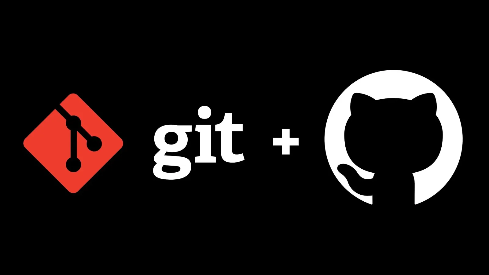

Git is a powerful and widely used version control system that allows developers to track changes, collaborate on projects, and manage codebase efficiently. Whether you're a beginner or an experienced developer, mastering the essential Git commands is crucial for effective version control and collaboration. But there is so much confusion in the world of Git and GitHub or we can say the version control system (VCS). Let's clarify some concepts first and then we will dive deep into Git commands.

First, Let's clarify that Git and GitHub are two different things. Although they are related to each other but not the same.

**What is Git? Git is a distributed version control system that enables efficient tracking of code changes and collaborative development.**

It simply lets us keep track of the changes that we make in our code and share them with other developers in our team. For example yesterday night you were making a game. you were halfway through it and everything was working fine as per the requirements. But today morning you did something wrong which lead you to crash the whole codebase and you are trying to solve the problem for the last 2 hours without even taking your breakfast but nothing working. Right now you would be more than happy if you can get the code in the state that it was yesterday night, aren't you? There comes the concept of the version control system. What if you can save a snapshot of your codebase every time you want and later on if something goes wrong you can just get on in a time machine and go back to the last time when the code was working fine? I always think of it like in a game where there are multiple checkpoints in each stage and if you die you can restart from the last checkpoint.

Now what if one day your computer is dead without any reason or some bad guy stole your machine? Do you lose all of the code that you have written in the last month without even taking a shower? Here comes the concept of keeping your code along with the version control system somewhere in the cloud(as they say. actually it is just another computer or server in some other part of the world).

**What is GitHub? GitHub is a web-based platform for hosting, sharing, and collaborating on software development projects using Git.**

Think of it just like keeping all of your code along with the snapshots of your code you took from time to time or the version control system(Git in our case) on the internet. So that no matter what happens to your personal computer you get the code just by logging in to the VCS(Version Control System) service provider (GitHub in our case). And the bonus part is as the code is on the internet, you can collaborate with other developers for the development. if there are 5 features that you would like to implement in your software you can ask 4 other developers to work for you. they will get the code from GitHub(Obviously you will authorize them) and work parallelly with you at the same time.

One thing we need to keep in mind is that Git is not the only software available for version control or SCM(source code management). There's **Mercurial** which is known for its simplicity and many more are there.

Also, GitHub is not the only service provider that provides the service to host codes with Git. there's **GitLab. BitBucket** and many more. Big companies like Google uses their own platform to host their codes.

But Git is the most popular among all version control systems and GitHub is the most popular to host Git Repositories(projects that use Git for VCS). That is the reason we are learning the most important command of Git to rule the world of programming.

Now follow me and run the commands on your own to get the best output. Create a folder in your desired directory (in the Documents directory for me). To do so from the file explorer go to the Documents folder and create a new folder with the name **"myNewRepository"**

If you are in the Linux terminal write the following command to do the same thing.

```bash
cd ~/Documents
mkdir myNewRepository
cd myNewRepository
```

Now create two files in the folder just created by you with the name "hello.py" and "bye.py".

Inside the first file type

```python
print("hello world!")
```

and save.

open the second file and type

```python
print("bye world!")
```

and save.

now first install let's install git in our computer.

Windows users open Powershell and type the following command to install git on their computers. if it shows any prompt then choose yes.

```bash
winget install -e --id Git.Git
```

If you face any problems while installing on Windows go to [https://git-scm.com/download/win](https://git-scm.com/download/win) and download the executable file and install.

And Linux users open the terminal and type the following command:

```bash
sudo apt-get install git
```

if it asks for a password type your system password that you use to log in when starting your computer.

Now close the terminal and reopen it, and go to myNewRepository with the `cd` command:

```bash
cd ~/Documents/myNewRepository
```

Before your first commit, tell Git who you are. Git adds this name and email to every commit you make, and it will not let you commit without them. You only need to do this once on each computer.

```bash
git config --global user.name "Your Name"
git config --global user.email "you@example.com"
```

## 1\. `git init`

To start using Git in a project, you need to initialize a Git repository. The `git init` command is used to create a new Git repository in a directory. It sets up the necessary internal Git files and structures, making the directory ready for version control. You do it only once in the lifetime of a project. One of the important things while writing Git commands is that, in the terminal, you need to be inside the folder. In our case, we need to be in the myNewRepository and then type the following command. to check if you are in the right folder type pwd and hit enter, if the last word of the output is the folder you are working with(myNewRepository) then you are fine.

```bash
git init
```

## 2\. `git add`

Before committing changes, you need to stage them. Now what does this "commit" and "stage" mean? commit means taking a snapshot of your code at the current time. A commit records the state of your files at that moment. Git stores each commit as a full snapshot, and it can show you which lines were added, changed or deleted compared with the commit before. Each commit also stores metadata (information about the data) such as the author's name, email, date, and a commit message explaining the purpose of the changes. And "Staging" refers to the process of preparing changes in the code of your working directory to be included in the next commit.

The `git add` command adds changes from your working directory to the staging area, preparing them for the next commit.

```bash
git add <file(s)>
```

Here, after the add command if you want to only add one or two files you need to write them implicitly. for example, there are two files named hello.py and bye.py I have modified and I want to add them. The command would be

```bash
git add hello.py bye.py
```

but what if there are 10 files I have modified and want to commit? Do I need to write all of their names? In that case, we can use the (.)period instead of writing the names. the command would look like

```bash
git add .
```

## 3\. `git commit`

Once your changes are staged (after the git add command), you can create a commit. Commits are snapshots of your code at a specific point in time. git commit command will commit(take a snapshot of) all the codes that we have added to the staging area with the git add command. the following command will commit all the 10 files that we have added previously. so if you want to commit one or two specific files then don't use (.) in the git add command instead write the name of the specific file after git add.

```bash
git commit -m "Your commit message"
```

## 4\. `git status`

To see the status of your working directory and staged changes, you use the `git status` command. It shows which files are changed but not staged, which files are staged but not committed, and whether you have commits that are not pushed (uploaded) to the remote repository (GitHub) yet.

```bash
git status
```

**Okay so now that you have committed the changes to your code you need to upload them in GitHub**. **How can you do so?**

For that, first, you need to create a repository/folder in GitHub.

If you do not have a GitHub account create one and then click on the + icon beside the search bar.

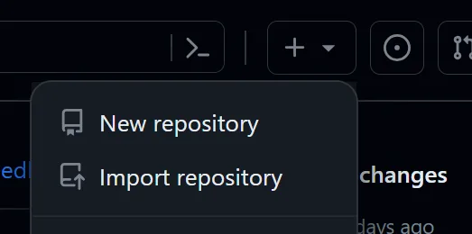

Select New repository

after that, you need to write the name of your repository. Try to keep the name the same as the one on your computer.

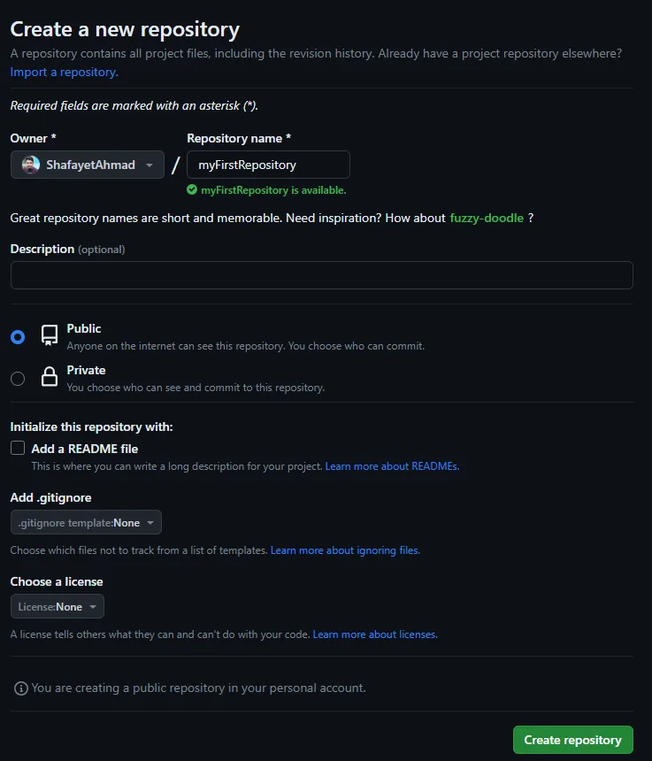

Keep it public if you want to share it with everyone visiting your profile or private if only you want to use it. for now, let's keep it public as there is nothing secret in our hello.py and bye.py.

Then click Create Repository.

Now you will be shown the following commands. here we can go for the second part where it says to push an existing repository from the command line.

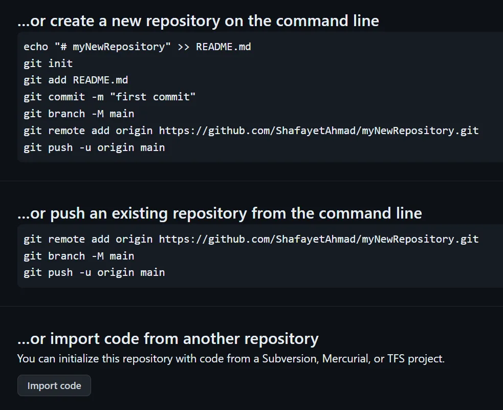

type the given commands one by one.

## 5\. `git remote`

Remote repositories are copies of your project hosted on other servers. The `git remote` command helps you manage connections to remote repositories.

```shell
git remote add <remote_name> <repository_url>
git remote -v                     # List remote repositories
```

For our case, git remote add origin, and then the git link of the remote repo.

```bash
git remote add origin https://github.com/yourUserName/myNewRepository.git
```

Here git remote add origin means we want to connect a remote repository (A repository on the internet) with the repository in our local machine. the link after the origin is the link to the remote repository. And origin will be the name of the remote link the next time.

Then,

```bash
 git branch -M main
```

Here we are going to set main as the main branch of our project. Now what is this "branch" thing? we will get to this in a moment. now just keep doing what it is saying.

Now the next command is

```bash
git push -u origin main
```

Here we are pushing(uploading our codes to the remote repository in GitHub). For making things simple, I will suggest you install GitHub CLI from [https://cli.github.com/](https://cli.github.com/) before running this command.

after installing GitHub CLI. open a terminal/PowerShell and type

```bash
gh auth login
```

here you will be given some options. navigate using the up arrow and down arrow and select using enter button. select according to the following.

* Github.com

* HTTPS

* type y and enter

* Login with a web browser

Now you will be given a code. you can write it on a piece of paper and then click enter. a browser window will open. if you are not logged in to GitHub then log in first. Now write the code you just copied and continue. You will be asked to authorize GitHub. click on the green button that says Authorize GitHub.

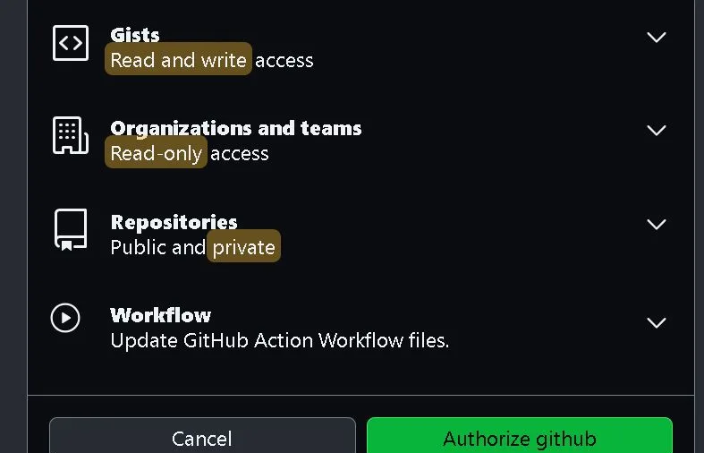

Boom. you are all set now. Go back to the PowerShell window, navigate to myNewRepository, and type:

```bash
git push -u origin main
```

You have successfully uploaded your code to Github.com. you can check that by going to github.com and then your profile.

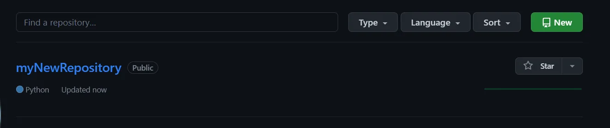

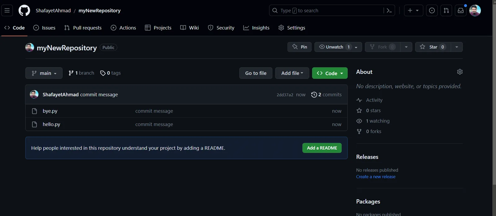

From now on if you are working in the same directory then each time you want to commit your code and upload on GitHub just type these three commands.

```bash
git add .
git commit -m "commit message"
git push
```

**Now that is enough for you to begin with Git/GitHub. You can upload a copy of your codes on GitHub. But as a developer, you need to collaborate with other developers, and also in case you messed up with your code you need to go back to a previous commit. For that, you need to master many more commands. Let's do that.**

## 6\. `git branch`

Branches allow you to work on different features or fixes concurrently. The `git branch` command helps you manage branches in your repository.

In a git repository, we can create multiple branches (separate lines of work on the same code). for example when more than one developer works in the same repository, to implement different features they create one branch each to keep the code safe. let's say we are writing code in 10 different files in one repository for the last 2 months. today we decided that from now on, 10 different programmers will work on those 10 different files and collaborate with each other. so every programmer will create their own branch inside the repository. Let's make this clearer.

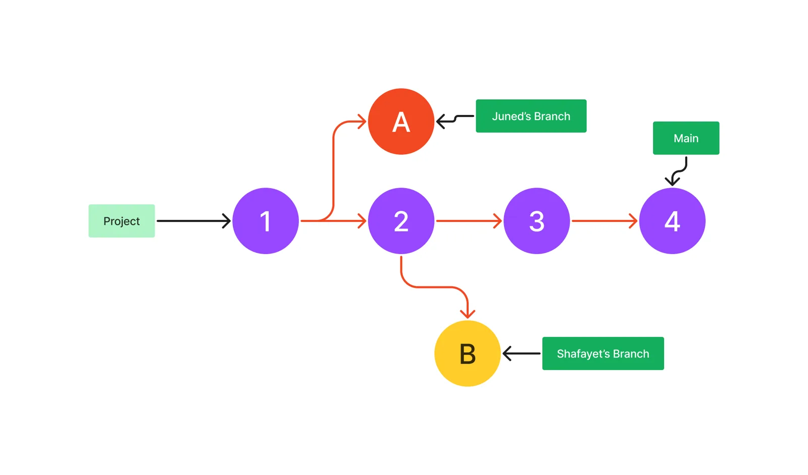

Here in the image, we can see the project starts with one branch which is the main branch. Generally in big projects we don't commit directly to the main branch. For fixing any bug or implementing a new feature we create a new branch and modify the code there. Guess that there's a bug(problem) in our code and a developer named Juned is assigned to solve that. What juned will do is he will create a branch with the name A.

```bash
git branch                        # List all branches. in our case it will only output main
git branch A                      # Create a new branch named A
git checkout A                    # Now current branch is A. and all the work he does will be on this branch only without changing anything on the main branch
```

This branch will contain all code until the time when the branch is created. Juned will work on the branch with solving the bug and nothing else, And no one else will work on the bug and the file that juned is working on.

## 7\. `git checkout`

The `git checkout` command is used to switch between different branches. It can also take you to an earlier commit so you can look at your code as it was then. In Juned's case after he created branch A he switched from branch main to branch A with the command 'git checkout A'.

```bash
git checkout <branch_name>        # Switch to a different branch
git checkout <commit_hash>        # Look at the code as it was at a commit
```

git checkout is also used to go back to a specific commit. In our game example, we talked about earlier, we can get back to the code at the state of the previous night with the hashcode of the commit. now what this hashcode is? every commit in git has its unique hashcode and we can get back to the state of our codebase to this hashcode using git checkout. Git calls this a "detached HEAD": you can look around and test the old code, but new commits you make here don't belong to any branch. Run `git checkout main` to come back.

Newer versions of Git also have `git switch <branch_name>`, which does only the branch-switching part of `git checkout`.

## 8\. `git log`

The `git log` command displays a chronological list of commits in your repository. It's useful for reviewing the commit history.

```bash
git log
```

We can use Git log to see all the previous commits

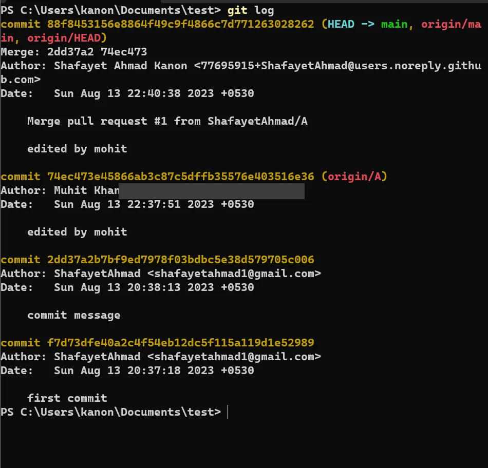

or else we can go to the remote repository and click on the commit count(4 commits here) and we will be taken to the commits section.

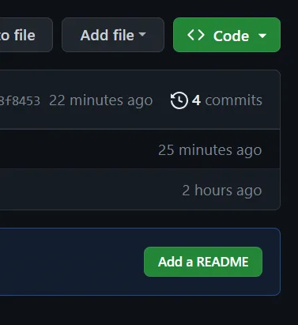

we can see here there are 4 commits each one with its hashcode on the right side. Let's assume that we want our code to be the same as it was in the second commit with the hashcode 2dd37a2.

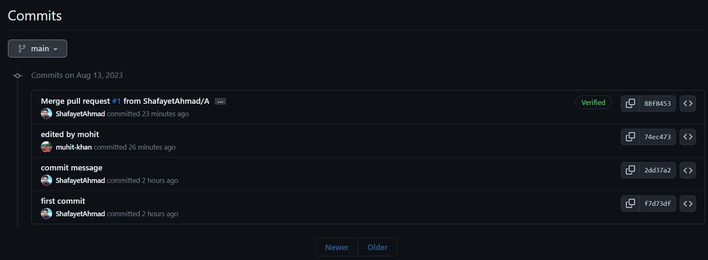

we will write the command as

```bash
git checkout 2dd37a2
```

Now we can look at our code as it was at that time. but if we want it to be like this forever then what we can do is:

## 9\. `git reset`

The `git reset` command is used to unstage changes from the staging area or move the current branch to a specific commit.

```shell
git reset <file(s)>               # Unstage changes
git reset --hard <commit_hash>    # Move branch to a specific commit
```

We need to reset our head to the commit hashcode. so we will type the command

```bash
git reset --hard 2dd37a2
```

But we need to be careful as this will delete all the code that was added after that specific commit. It also throws away any changes you have not committed yet. And if you have already pushed those later commits, GitHub will refuse a normal `git push`. You would have to force it, which rewrites history your teammates already have.

On a shared branch, use `git revert` instead. It makes a new commit that undoes an earlier one, so nothing is deleted:

```bash
git revert <commit_hash>
```

## 10\. `git push`

Now let's get back to Juned fixing the bug. After he fixes the bug he will push this A branch into the remote repository. the command will be as follows:

```bash
git push origin A 
```

Here juned is pushing the code in the A branch of origin(name of the remote repository).

**NB: We assume that this is a team project and everyone is working on the same remote repository.**

Now forget about juned and the team. Normally when you're ready to share your local commits with others, the `git push` command is used to upload your changes to a remote repository.

```bash
git push <remote> <branch>
```

You don't need to type the remote(origin in our case) and branch(main/A in our case) every time you push. you can just use git push. But if you have multiple remote URLs or multiple branches then you need to explicitly tell the code to be pushed in which remote URL and also if your repository has multiple branches then you need to tell in which branch of your remote repository you want to push.

for example, if I want to connect myNewRepository to another remote repository named test that I have created in my GitHub account. I will do the following

```bash
git remote add link2 https://github.com/ShafayetAhmad/test.git
```

So now my local repository myNewRepository is connected with two remote repositories origin(for https://github.com/ShafayetAhmad/myNewRepository.git) and link2(for https://github.com/ShafayetAhmad/test.git). now if I want to upload the codes to the test repository I need to do the following.

```bash
git push link2 main
```

Here I am saying to my terminal that I want to upload my codes to the main branch in the link2 repository which I set earlier to the Test repository.

## 11\. `git merge`

Merging combines changes from one branch into another. It's often used to integrate feature branches into the main branch.

```shell
git checkout <target_branch>
git merge <source_branch>
```

Juned did all his work in the A branch. To merge the A branch into the main branch, he first switches to main and then merges A into it:

```bash
git checkout main
git merge A
```

This brings Juned's fix from A into main. The order matters: `git merge` always brings the branch you name into the branch you are on.

In a real team, Juned would usually not merge into main himself. He would push branch A and open a pull request on GitHub, so a teammate can review the fix before it is merged.

Once A is merged we don't need it anymore, so we can safely delete it using the following command:

```bash
git branch -d A                        # this will delete the A branch
```

## 12\. `git clone`

So far we started from our own folder. When you join an existing project, you start with `git clone` instead of `git init`. The `git clone` command allows you to copy a remote repository onto your local machine. Here remote means the project/codebase is somewhere on the internet(Ex: in GitHub). to get the code in our computer (or to clone the code in our local computer) you can use this clone command.

Keep in mind that this will clone the project/repo(short for repository) in the folder where currently you are in. so make sure to change to the directory/folder before cloning.

```bash
git clone <repository_url>
```

For example, if you want to clone the repository from this ([https://github.com/ShafayetAhmad/OSContribution](https://github.com/ShafayetAhmad/OSContribution)) URL. type the following command in your terminal/cmd/PowerShell

```bash
git clone https://github.com/ShafayetAhmad/OSContribution
```

## 13\. `git fetch`

The `git fetch` command retrieves updates from a remote repository without automatically merging them. This is useful for reviewing changes before merging.

```bash
git fetch <remote>
```

If any change is there in our remote repository we can fetch the changes without merging them with the following command.

```bash
git fetch
```

## 14\. `git pull`

To fetch and merge changes from a remote repository into your local branch, you use the `git pull` command. This is important to keep your local repository up-to-date with the latest changes. git pull combines both git fetch and git merge command.

```shell
git pull <remote> <branch>
```

Here remote and branch are not important if you are working with only one remote URL and one branch. but if you are working with multiple remote URLs and branches then you need to explicitly tell which branch and remote link to pull from. For our case we can do as follows:

```bash
git pull origin main
```

## 15\. `git stash`

When you're in the middle of something and need to switch branches, but don't want to commit your changes, you can use the `git stash` command to temporarily save your changes.

```shell
git stash                         # Save changes
git stash apply                   # Apply saved changes
```

These essential Git commands lay a strong foundation for efficient version control and collaborative development. As you continue your journey in software development, you'll likely discover additional Git commands and advanced techniques that further enhance your productivity and collaboration skills.

Remember, Git is a powerful tool that can greatly streamline your development workflow. Take the time to practice and understand these commands, and you'll be well on your way to becoming a Git guru. Happy coding!
