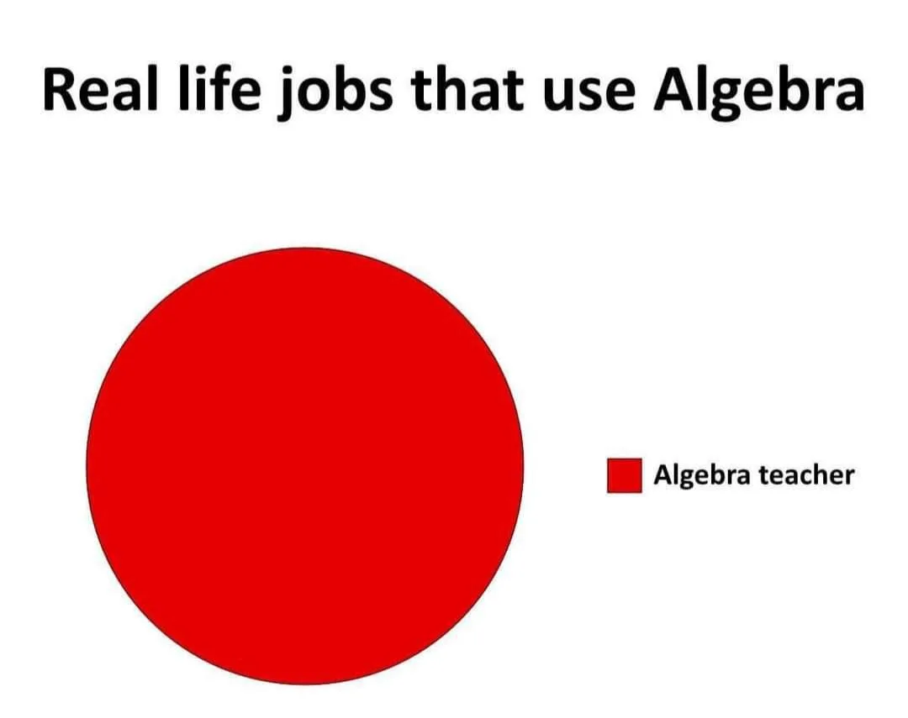

## My experience!

While I was in (not the best) high school in my local town in Bangladesh, I remember asking at least five of my teachers why Algebra was necessary. I would always ask why we needed to mix letters with numbers in math. What’s the point of an equation like 5x + 6y = 9, 3x + 2y = 10 in real life?

Not surprisingly, they were unable to satisfy me with appropriate answers. But one of them (Bijoy Sir) was different. He used to encourage me to search for the answer myself. I still remember, one day in 9th-grade physics class, he came in excited, saying he had just learned that computers only work with 0s and 1s. He looked amazed and said something that sparked my interest in computer science. He said, “I hope some of you study these things one day and come back to teach me how computers work with just 0s and 1s.” That got me thinking. The idea that I could one day come back and teach my teacher was thrilling, especially for a kid my age (13).

Now that I have been studying computer science for five years, I know just how integral mathematics is to the field. Let me share some of the roles mathematics plays in computer science.

## Algebra

**Linear Algebra**: The backbone of any calculation and for finding unknown values, it powers the world of data science and graphics that we see on screens. It is used heavily in artificial intelligence and machine learning to perform matrix operations in data transformation, image processing, and neural networks.

**Boolean Algebra**: Fundamental to computer science and computers. It is the building block for logical systems and digital circuits.

## Discrete Mathematics

**Graph Theory:** Used for modeling networks and optimizing routing in social media, maps, or databases.

**Combinatorics:** Essential in cryptography, encryption, and algorithm design for evaluating possible configurations.

## Probability and Statistics

**Probability:** Used in building predictive models in AI, such as recommender systems that are used by E-commerce systems to recommend products on the homepage for a particular customer or in social media feed based on previous interaction data.

**Statistics:** Used to analyze trends in data in data science and validate models through regression and hypothesis testing.

## Number Theory

**Prime Factorization and Modular Arithmetic:** Core to encryption. RSA relies on how hard it is to factor very large numbers, and modular arithmetic also appears in hashing.

## Geometry and Trigonometry

**Analytic Geometry:** Used in 3D graphics to position and transform virtual objects.

**Trigonometry:** Calculates angles and perspectives in computer vision and game development for realistic rendering.

## Calculus

**Differential Calculus:** Applied in machine learning to minimize error functions through gradient descent.

**Integral Calculus:** Essential in rendering 3D graphics, lighting, and calculating motion in animation.

## Back to 5x + 6y = 9

So what about the equations I complained about in school, like 5x + 6y = 9 and 3x + 2y = 10? Solving a set of equations like this for unknown values is exactly what computers do all the time, just with thousands or millions of unknowns instead of two. Fitting a straight line to data, one of the first things you learn in machine learning (linear regression), comes down to solving a system of linear equations. And 3D graphics uses matrices, the same algebra, to work out where every point of an object lands on your screen.

I’m still a student and learning, so I might make occasional mistakes. I’d appreciate any corrections in the comments or via LinkedIn message.
