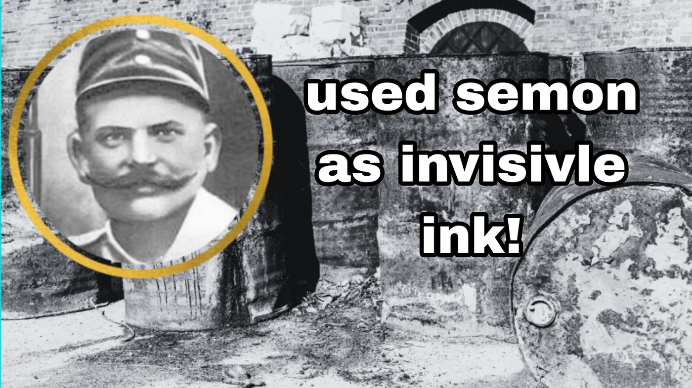

Back in the days of World War I, the British Secret Service Bureau (which later became MI6) discovered that semen could actually serve as invisible ink. Yes, you read that right. Britain's spies got a bit *creative* when Captain Sir Mansfield George Smith-Cumming suggested this unique method to hide secret messages. Apparently, it was a clever way to keep things under wraps from the Central Powers, although today, it might make you chuckle or scratch your head in disbelief. Luckily, in the age of the internet, we’ve moved on to more sophisticated, and let’s say less *awkward*, methods of keeping secrets. But it’s proof that spies have always been good at thinking *outside* the box.

While the story above is an example of steganography, today’s topic is different. Today, we will discuss how, in this age of the internet, we hide messages from others, not only on our phones or computers but also on the internet.

## What is Encryption?

Encryption is the technique of scrambling data so that only someone with the right key can read it. It has been used since the ancient age of empires, and the earliest known example is often traced to Egypt around 1900 BC. Hieroglyphs carved into the tomb of Khnumhotep II displayed non-standard symbols considered to be a form of encryption, essentially marking the earliest evidence of cryptography. One of the earliest and most famous examples of encryption was used by Julius Caesar to protect his military messages. In this cipher, each letter in the plaintext is shifted by a fixed number of positions in the alphabet. We will look at the example and formation of Caesar Cipher when we talk about Symmetric encryption. Al-Kindi, an Arab polymath, made significant contributions to cryptanalysis and is often credited as the first person to formally describe letter frequency analysis, which involves analyzing the frequency of letters in a ciphered text to decode it. We will discuss this also.

## The History!

Wartime generally creates a greater need for scientific advancements than at any other time, and like many other scientific discoveries and inventions, many cryptographic and encryption-related discoveries were invented during and after the First World War, Second World War, and Cold War, among others.

The Enigma Machine used by Nazi Germany during World War II is one of the most famous and sophisticated encryption devices in history. It used a series of rotating wheels to scramble messages, and the machine’s settings changed daily, making it incredibly difficult to decrypt without knowing the settings. At that time, messages encrypted using an enigma machine were considered unbreakable. However, it was broken. Polish cryptologists Marian Rejewski, Jerzy Różycki and Henryk Zygalski first broke Enigma in the 1930s and shared their work with Britain and France in 1939. At Bletchley Park in the UK, Alan Turing and many others built on it to read German messages for much of the war. And then, with the development of modern computers during the Cold War, we saw the Rise of Public-Key Cryptography.

In this article, I will give an overview of current encryption techniques.

Encryption techniques can be divided into two types: Symmetric Encryption and Asymmetric or Public Key encryption.

## Symmetric Encryption

In Symmetric Encryption, we encrypt our message with an algorithm and a secret key. To decrypt the message into plain text or in the form that it was before encrypting, we need the same algorithm and the same secret key that was used during encryption. In modern cryptography, the algorithm is assumed to be public (this is called Kerckhoffs's principle), so all the security rests on the key. Anyone who has the key can read the message. Until public-key encryption arrived in the 1970s, symmetric encryption techniques were the only way to encrypt messages.

Earlier, we discussed the Caesar cipher, one of the earlier encryption techniques. Now, let’s understand how Caesar’s cipher works.

Caesar cipher, also known as the shift cipher, is one of the simplest and earliest encryption techniques. It works by shifting the letters in a message by a fixed number of places in the alphabet. The alphabet is treated as a circular sequence (e.g., after ‘Z’ comes ‘A’). Each letter in the plaintext is shifted by a fixed number, known as the key. To encrypt a message, each letter in the plaintext is replaced by the letter that is a fixed number of positions down the alphabet.

For example, with a shift of 3:

‘S’ → ‘V’, ‘H’ → ‘K’, …, ‘A’ → ‘D’, ‘F’ → ‘I’, ‘Y’ → ‘B’, ‘E’ → ‘H’, ‘T’ → ‘W’

So “SHAFAYET” becomes “VKDIDBHW”.

Decryption reverses the process by shifting in the opposite direction.

For a shift of 3:

‘V’ → ‘S’, ‘K’ → ‘H’, …, ‘D’ → ‘A’, ‘I’ → ‘F’, ‘B’ → ‘Y’, ‘H’ → ‘E’, ‘W’ → ‘T’

And “VKDIDBHW” again turns into “SHAFAYET”.

However, as we can see, it is not a strong encryption technique. With only 25 possible keys (shifts), it is easy to brute-force. Additionally, since the Caesar cipher does not change the frequency of letters, it is vulnerable to frequency analysis attacks, as we discussed earlier. Al-Kindi’s analysis of letter frequency is one of the earliest documented works in cryptanalysis from the 9th century.

Letter frequency analysis is a cryptanalytic technique used to break substitution ciphers, including Caesar ciphers. This method exploits the fact that certain letters appear more frequently in a language than others. For example, in the English language, letters such as E, T, A, O, I, and N are more common, while Z, Q, X, and J are rarer. These patterns vary across languages but are consistent enough within each language to be exploitable.

When a ciphertext is intercepted, the frequency of each letter can be compared to the expected frequency of letters in the language. This comparison helps cryptanalysts deduce the substitution scheme. For instance, if the most frequent letter in the ciphertext is G and the most frequent letter in English is E, it might be hypothesised that G represents E. By extending this comparison across the entire ciphertext, cryptanalysts can systematically reconstruct the substitution pattern.

Although the Caesar cipher is rarely used today, symmetric encryption remains an important piece of modern computing and network security, alongside public key encryption. In contemporary applications, symmetric block encryption algorithms are the primary tools for securing data. These algorithms operate by dividing plaintext into fixed-size blocks, which are then encrypted to produce ciphertext blocks of the same size. Longer plaintexts are processed sequentially, one block at a time, using the encryption algorithm.

The most common symmetric encryption algorithms, all of which are block ciphers, include:

- DES (Data Encryption Standard) is an early encryption standard that is now largely obsolete due to its short key length.
- Triple DES (3DES): An enhancement of DES that applies the DES algorithm three times to each data block. It was more secure than DES, but it is slow, and NIST has now retired it too.
- AES (Advanced Encryption Standard) is the current standard for encryption. It offers robust security and efficiency and is widely adopted across industries.

Now, let’s see what Asymmetric or Public-Key encryption is.

## Then why Asymmetric or Public-Key Encryption?

One significant limitation of symmetric encryption is the requirement that both the sender and receiver use the same key. If an unauthorised party gains access to this key, they can decrypt the messages and compromise the entire communication. To address this vulnerability, public key encryption was introduced, a groundbreaking concept proposed by Diffie and Hellman in 1976. A year later, Ron Rivest, Adi Shamir and Leonard Adleman published RSA, the first widely used public-key encryption method. (Clifford Cocks, a mathematician at Britain's GCHQ, had found the same method in 1973, but his work stayed secret until 1997.)

Public key encryption is based on complex mathematical functions rather than simple operations on bit patterns. Its key innovation lies in the use of two distinct keys: a public key for encryption and a private key for decryption. The public key can be freely shared, allowing anyone to encrypt a message intended for a specific recipient. However, only the recipient, who holds the corresponding private key, can decrypt the message. Since the private key is never shared, it remains secure even if the public key is widely distributed. This separation of keys not only resolves the key-sharing problem but also forms the foundation of secure communications in modern cryptography.

Public key encryption is commonly used to secure communications over the internet in TLS (the successor to SSL), which encrypts data exchanged between web browsers and servers. When we visit a secure website (one whose link starts with https), TLS ensures that the data exchanged between your browser and the server is encrypted.

Simply put, it works like this. The server sends the browser its certificate, which contains its public key. The browser and the server then use a key exchange method called Diffie–Hellman to agree on a shared symmetric key, without ever sending that key across the network. The server also signs part of this exchange with its private key, which proves to the browser that it is talking to the real website. From then on, all data is encrypted with the shared symmetric key (for example, with AES), because symmetric encryption is much faster. Older versions of TLS also allowed a simpler method, where the browser made up the symmetric key and encrypted it with the server’s public key, but TLS 1.3 removed it.

Public key encryption is also used in digital signatures, encrypted email and many other scenarios. Like everything in this world, it has limitations too: it is much slower than symmetric encryption and needs much longer keys. This is enough for today.
